# MyDevPortal

A privacy-first developer productivity PWA for learning, building, focusing, and quietly managing your career — built with **Laravel 13**, **Inertia v3**, **Vue 3**, **TypeScript**, and **Tailwind CSS 4**.

MyDevPortal keeps the whole developer loop in one calm workspace: projects, tasks, learning resources, private notes, and a career timeline. No analytics, no ad trackers, no growth dashboards — just your work.

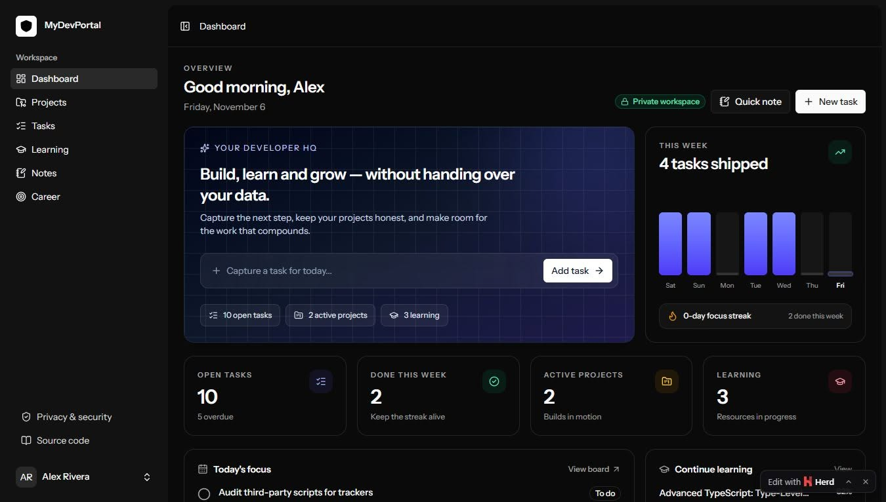

## Why MyDevPortal

- **One workspace, the whole loop** — plan a build, capture the next task, track what you are learning, keep private notes, and record career wins without juggling five apps.
- **Private by default** — notes, applications, and goals are scoped to your account. There are no third-party scripts or trackers.
- **Installable and offline-ready** — a web app manifest and service worker provide an app shell and an offline fallback page.
- **Keyboard-friendly and fast** — Inertia-powered navigation with a compact, responsive interface.
- **Self-hostable** — a standard Laravel application with SQLite by default, so you can run it anywhere.

## Screenshot tour

### 1. Dashboard

The dashboard is the daily starting point: open tasks, weekly output, active projects, learning progress, a career snapshot, and recent notes.


Below the fold, _Today's focus_ and _Active projects_ surface the work that needs attention now.

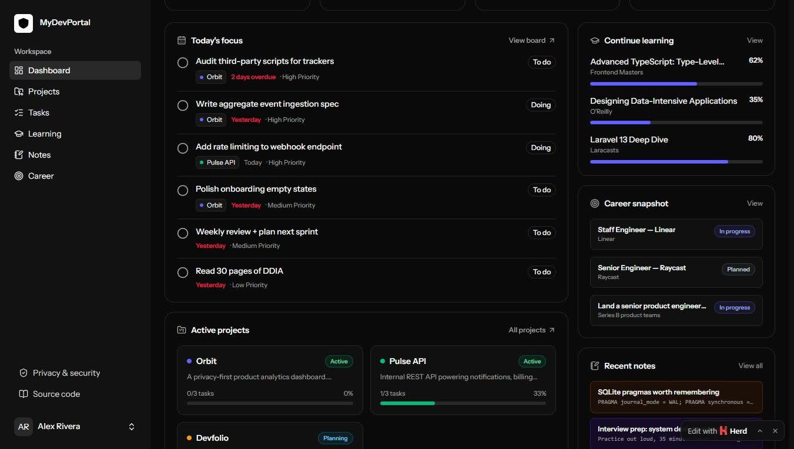

Tasks can be captured from the dashboard without leaving the page.

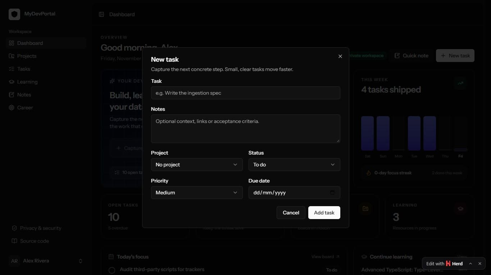

The same quick-capture flow works for private notes.

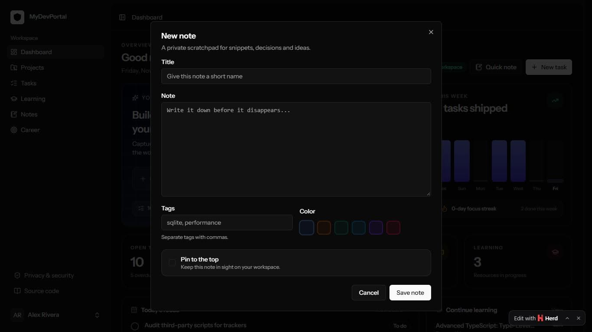

### 2. Projects

Every build, experiment, and long-running idea gets a home. Projects show status, accent colour, tech stack, target date, and task-based progress.

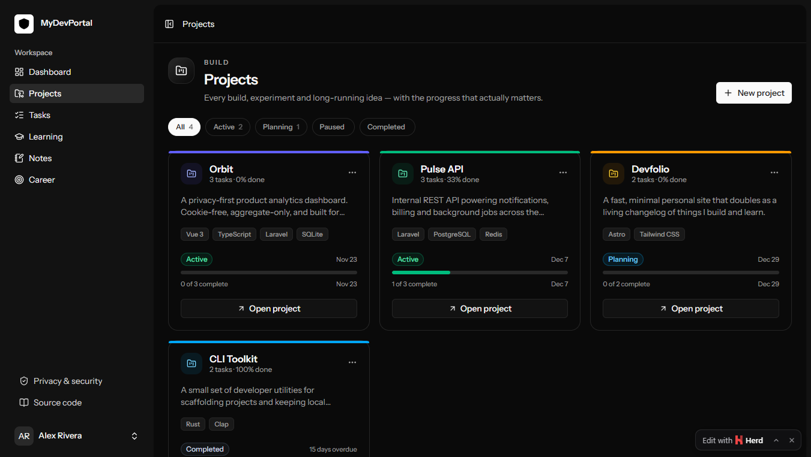

Create a project with a name, description, status, accent, tech stack, repository URL, live URL, and target date.

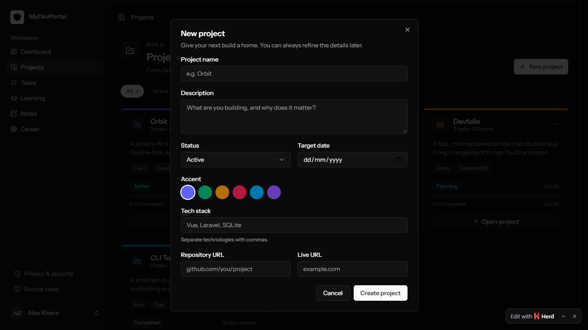

Edit a project as it evolves — status, links, and the target date stay in one place.

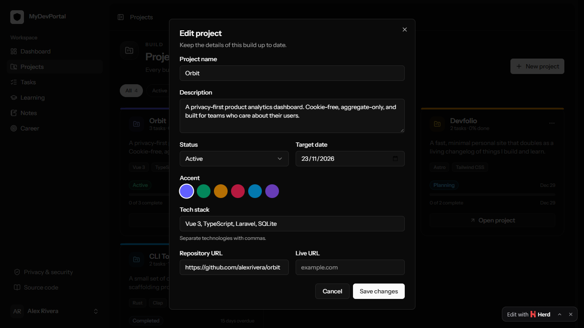

### 3. Tasks

The focus board organises work into **To do**, **In progress**, and **Done**. Search, filter by project, complete tasks in one click, or move them between columns from the task menu.

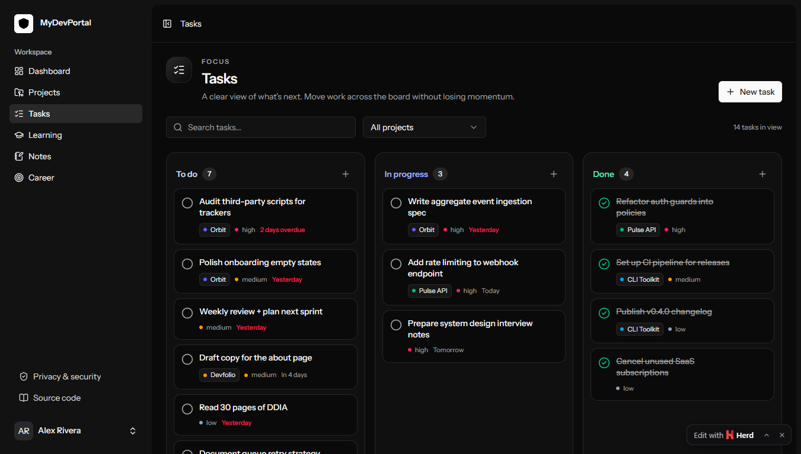

New tasks can be created directly into the column you are working in, with a project, priority, and due date.

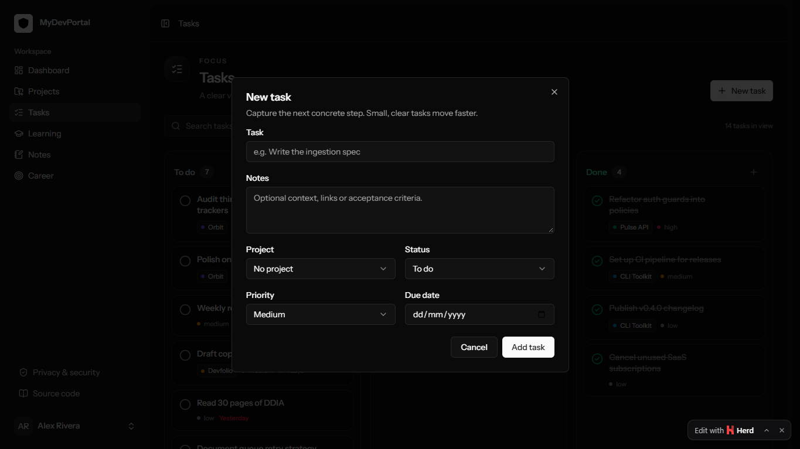

### 4. Learning

Track courses, books, articles, videos, and documentation in a personal curriculum. Filter by status, view average progress, and log progress in 10% increments.

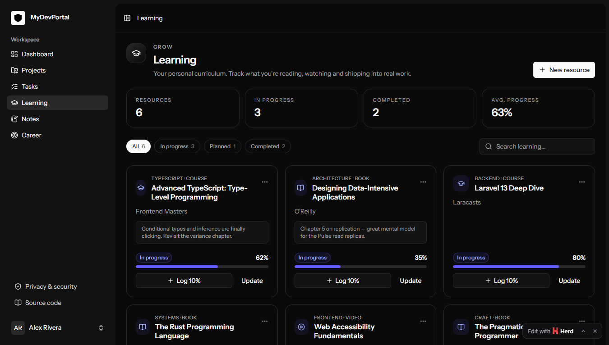

Add a resource with a title, provider, URL, category, format, status, and initial progress.

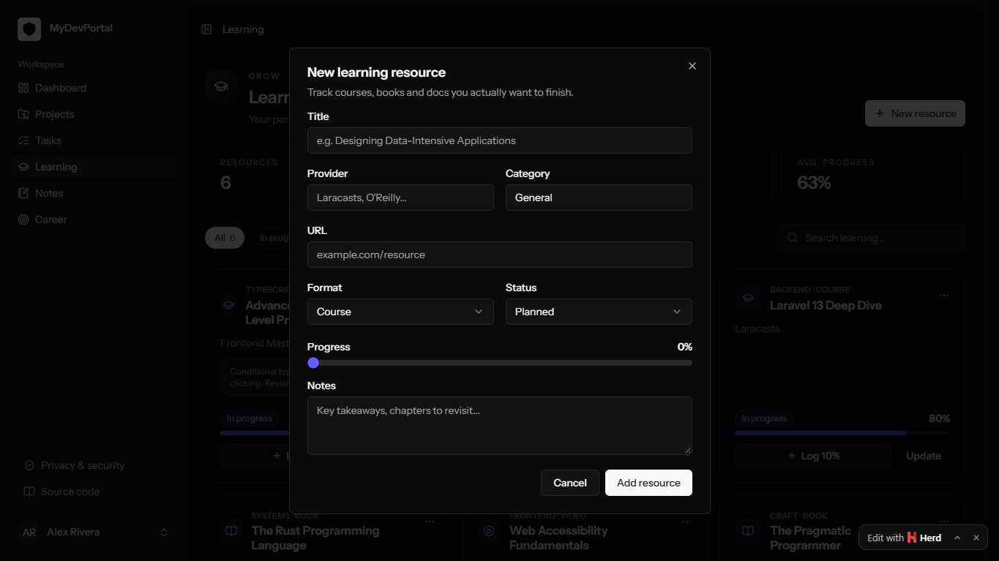

Update a resource's progress, status, and notes as you work through it. Reaching 100% marks it complete.

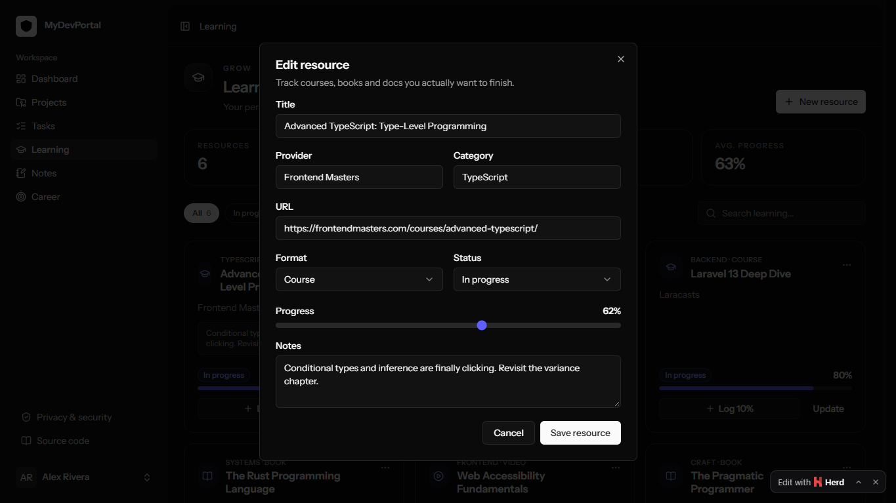

### 5. Notes

A private scratchpad for snippets, decisions, commands, and half-formed ideas. Pin important notes, search across content and tags, and colour-code them.

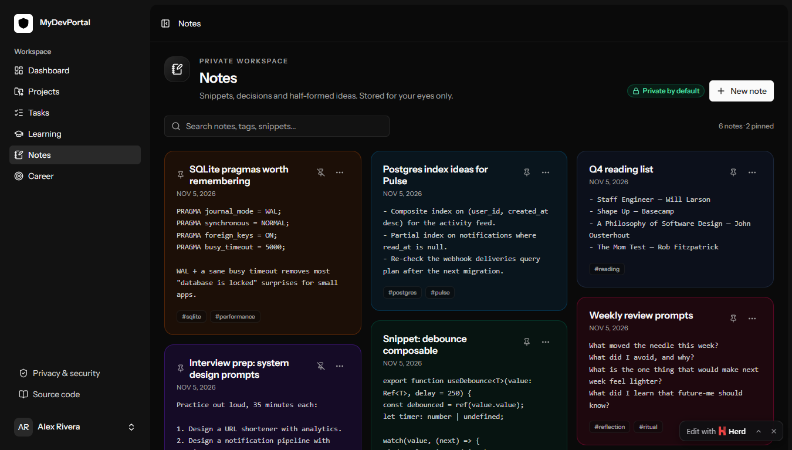

Each note exposes inline actions for editing, pinning, and deleting.

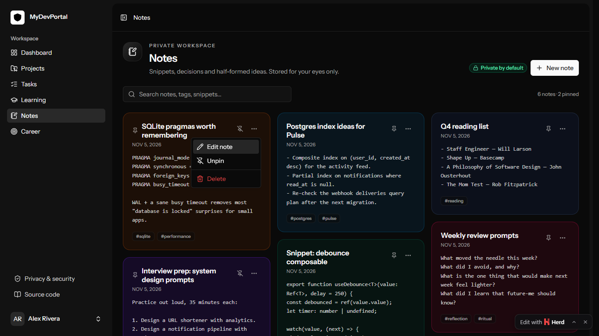

Create a note with a title, body, tags, colour, and an optional pin.

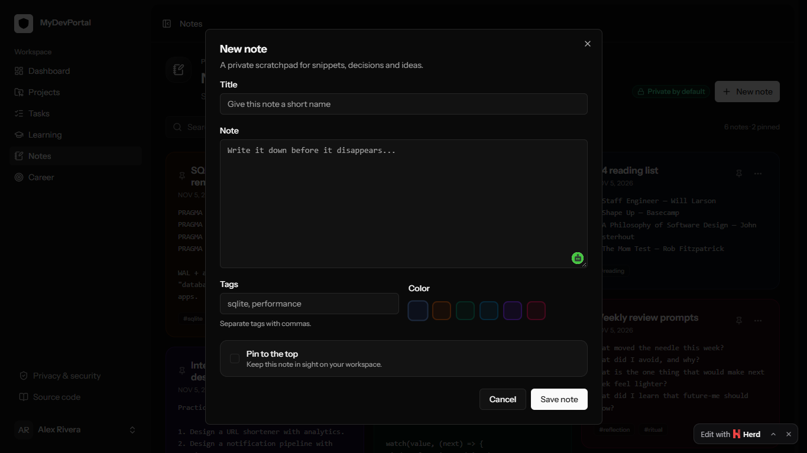

Edit a note in place — content, tags, colour, and pinned state.

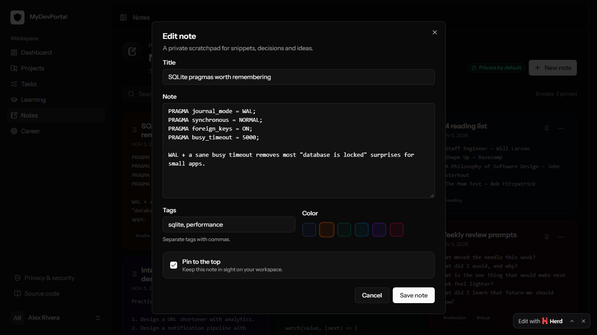

### 6. Career

A quiet record of where you are going and what you have already proven. Goals, applications, achievements, and certifications live in one private timeline with target dates.

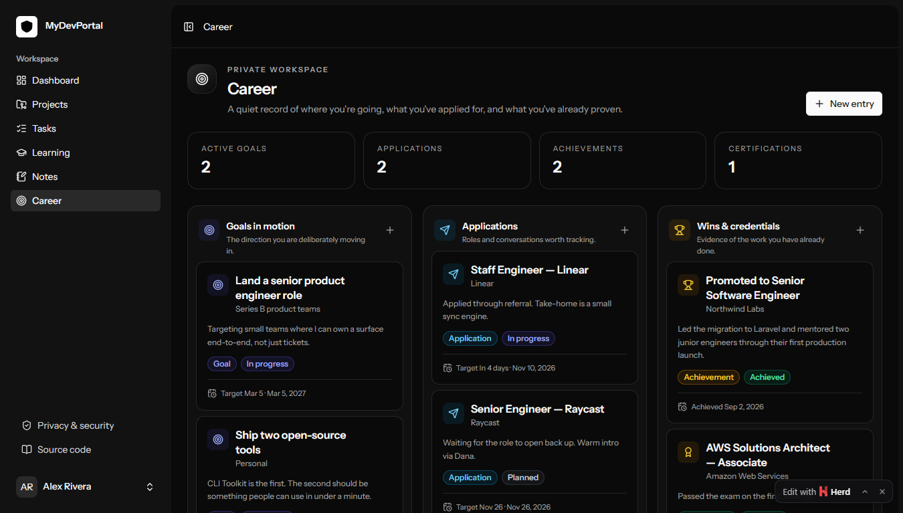

Add a career entry as a goal, application, achievement, or certification, with an organisation, status, target date, and description.

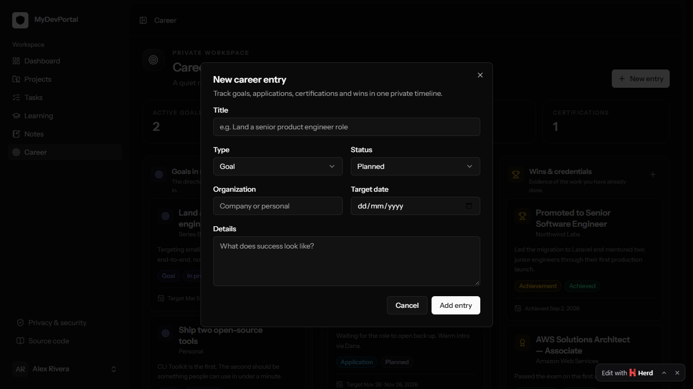

## Feature summary

| Module        | What it does                                                                                                                                                          |
| ------------- | --------------------------------------------------------------------------------------------------------------------------------------------------------------------- |
| **Dashboard** | Aggregates open tasks, weekly completions, focus streak, active projects, learning progress, career snapshot, and recent notes. Includes quick task and note capture. |
| **Projects**  | Full CRUD, status and accent colour, tech stack, repository/live URLs, target dates, and task-completion progress.                                                    |
| **Tasks**     | Three-column focus board, search, project filter, priorities, due dates, one-click completion, column moves, and full CRUD.                                           |
| **Learning**  | Courses, books, articles, videos, and docs with provider, category, status, progress tracking, filters, and progress logging.                                         |
| **Notes**     | Private notes with search, tags, colour coding, pinning, and full CRUD.                                                                                               |
| **Career**    | Goals, applications, achievements, and certifications with status, organisation, target date, and completion tracking.                                                |
| **PWA**       | Web app manifest, installable icons, service worker caching, and an offline fallback page.                                                                            |

## Tech stack

- **Backend:** Laravel 13, Inertia v3, Laravel Fortify (authentication, passkeys, 2FA)
- **Frontend:** Vue 3, TypeScript, Inertia Vue 3, Tailwind CSS 4, Reka UI, Lucide icons
- **Database:** SQLite by default
- **Build tooling:** Vite (via Vite Plus), `vue-tsc`, Pint, Pest, PHPStan
- **PWA:** hand-written manifest and service worker in `public/`

## Getting started

### Requirements

- PHP 8.3+
- Composer
- Node.js 20+
- SQLite (or another Laravel-supported database)

### Installation

```bash
composer install
cp .env.example .env
php artisan key:generate
touch database/database.sqlite
php artisan migrate --seed
npm install
npm run dev
```

On Windows, copy the environment file with:

```powershell
Copy-Item .env.example .env
```

If you prefer the bundled setup script:

```bash
composer setup
php artisan db:seed
```

### Demo account

The seeder creates a demo workspace with realistic projects, tasks, learning resources, notes, and career entries.

| Field    | Value                  |
| -------- | ---------------------- |
| Email    | `demo@mydevportal.app` |
| Password | `password`             |

You can also skip the login form by visiting **`/demo`**, which signs you in as the demo user and redirects to the dashboard.

### Production build

```bash
npm run build
php artisan migrate --force
```

The service worker registers automatically in production builds.

## Project structure

```text
app/
  Http/Controllers/          Dashboard and module controllers
  Models/                    Project, Task, LearningResource, Note, CareerEntry
database/
  migrations/                Domain tables
  seeders/DemoSeeder.php     Demo workspace data
resources/js/
  components/portal/         Create/edit dialogs for each module
  layouts/                   App, auth, and settings layouts
  lib/                       Colours, date helpers, shared utilities
  pages/                     Dashboard, Projects, Tasks, Learning, Notes, Career, Welcome
  types/portal.ts            Shared domain types
public/
  manifest.webmanifest       PWA manifest
  sw.js                      Service worker
  offline.html               Offline fallback
docs/screenshots/            README screenshots
```

## Routes

| Method         | URI                             | Purpose                                |
| -------------- | ------------------------------- | -------------------------------------- |
| `GET`          | `/`                             | Public landing page                    |
| `GET`          | `/demo`                         | One-click demo login                   |
| `GET`          | `/dashboard`                    | Workspace overview                     |
| `GET/POST`     | `/projects`                     | List and create projects               |
| `PATCH/DELETE` | `/projects/{project}`           | Update or delete a project             |
| `GET/POST`     | `/tasks`                        | Focus board and task creation          |
| `PATCH/DELETE` | `/tasks/{task}`                 | Update or delete a task                |
| `PATCH`        | `/tasks/{task}/toggle`          | Complete or reopen a task              |
| `GET/POST`     | `/learning`                     | Learning library and resource creation |
| `PATCH/DELETE` | `/learning/{resource}`          | Update or delete a resource            |
| `PATCH`        | `/learning/{resource}/progress` | Update learning progress               |
| `GET/POST`     | `/notes`                        | Private notes and note creation        |
| `PATCH/DELETE` | `/notes/{note}`                 | Update or delete a note                |
| `PATCH`        | `/notes/{note}/pin`             | Pin or unpin a note                    |
| `GET/POST`     | `/career`                       | Career timeline and entry creation     |
| `PATCH/DELETE` | `/career/{entry}`               | Update or delete a career entry        |

## Quality checks

```bash
php artisan test        # Pest test suite
vendor/bin/pint --test  # PHP formatting
npm run types:check     # Vue/TypeScript type checking
npm run check           # Formatting and linting
npm run build           # Production asset build
```

## Privacy

MyDevPortal is designed around ownership: your data stays in your own database, notes and career entries are scoped to your user account, and the app ships without third-party analytics or advertising trackers. Because it is a standard Laravel application, you can self-host it and back up the database yourself.

## License

This project builds on the Laravel Vue starter kit and is released under the MIT license.
