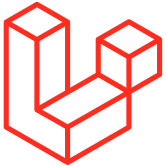

<div align="center">

<h1>MyDevPortal</h1>



<p>
  <strong><em>A Private Developer Workspace &amp; Command Center for Laravel Artisans</em></strong>
</p>

<p>
  Build, learn, focus, and track your career in one calm workspace—with local SQLite storage, PWA support, and NativePHP targets.
</p>

<p>
  
  
  
  
  
</p>
<p>
  
  
  <a href="https://github.com/jmdev11webdev/mydevportal/releases">
    
  </a>
</p>

<p>
  <a href="#why-mydevportal">Why MyDevPortal</a> •
  <a href="#features">Features</a> •
  <a href="#tech-stack">Tech Stack</a> •
  <a href="#getting-started">Getting Started</a>
</p>

</div>

---

## Why MyDevPortal

- **One workspace, the whole loop** — plan a build, capture the next task, track what you are learning, keep private notes, manage your pipeline, and record career wins without juggling five apps.
- **Private & local-first** — notes, applications, leads, and goals are scoped to your account with SQLite WAL local storage by default and zero third-party trackers.
- **Cross-platform ready** — runs as an installable, offline-ready PWA, a **NativePHP Desktop** app (`main` branch), or a **NativePHP Mobile** app (`mobile` branch).
- **Keyboard-friendly and responsive** — Inertia-powered navigation with a compact desktop layout and mobile-first floating action buttons and modals.
- **Sign in your way** — email and password, passkeys, two-factor authentication, or GitHub OAuth.
- **Ship the docs too** — generate a README from any project, preview it live, and copy or download the markdown straight into your repository.

## Features

### Build & Ship

- **Dashboard** — Daily command center featuring _Your Developer HQ_ quick task capture, an interactive _Overall Statistics_ distribution pie chart, and a _This Week_ shipping velocity chart.
- **Projects** — Full project CRUD with status tracking (`Planning`, `Active`, `Paused`, `Completed`), color accents, repository and live URLs, target dates, task-based progress bars, and multi-select tech stacks.
- **Tasks (Focus Board)** — Three-column board (`To do`, `In progress`, `Done`) with nested subtasks, priorities, due dates, project filtering, inline focus timers, and one-click completion.
- **Interactive Calendar** — Unified Month and Agenda views connecting scheduled events, bundled event tasks and subtasks, project milestones, career targets, and a mobile day-workspace modal.
- **Tech Stack Radar** — Personal inventory of languages, frameworks, databases, and hosting (including Devicon icons, Debian, Livewire, and Laravel Cloud) with custom stack naming, multi-select, and one-click presets (`TALL`, `VILT`, `RILT`, `MERN`, `MEAN`, `MEVN`, `PERN`, `LAMP`, `LEMP`, `T3`).
- **README Generator** — Live-rendered markdown README builder with project presets, shields.io badges, copy/download/reset actions, and mobile-responsive layout.

### Growth & CRM

- **Pipeline** — Spreadsheet-style outreach and client lead tracker with inline editing across `New`, `Contacted`, `Proposal`, `Won`, and `Lost` stages, deal value summaries, and mobile stage filtering.
- **Career** — Private timeline for goals, job applications, achievements, and certifications with target dates and completion tracking.
- **Learning** — Personal curriculum for courses, books, articles, videos, and documentation with status filters and 10% incremental progress logging.
- **Overall Statistics** — Cross-portal analytics covering task completion rates, CRM pipeline win rate and stage values, 7-day execution velocity, project/career/stack totals, and cached GitHub Release download counts (`.exe` and `.apk`).

### Workspace & Care

- **Notes** — Private scratchpad for snippets, decisions, and commands with search, tags, color coding, and pinning.
- **20-20-20 Eye Care** — Built-in eye-care break timer synchronized with active focus duration timers across the dashboard and calendar.

## Feature summary

| Module              | What it delivers                                                                                                 |
| ------------------- | ---------------------------------------------------------------------------------------------------------------- |
| **Dashboard**       | Quick task/note capture, Overall Statistics pie chart, 7-day velocity chart, today's focus, and active projects. |
| **Projects**        | Full CRUD, status & accent color, multi-select tech stack, repo/live URLs, target dates, and task progress.      |
| **Tasks**           | Three-column focus board, nested subtasks, priorities, due dates, focus timer, and calendar linking.             |
| **Calendar**        | Month & Agenda views, bundled event tasks, project/career milestones, and mobile day modal.                      |
| **Stack**           | Personal tech radar with custom stack names, multi-select, and presets (`TALL`, `MERN`, `MEAN`, etc.).           |
| **README**          | Live markdown README generator with project presets, Devicon badges, copy, download, and reset.                  |
| **Pipeline**        | Inline spreadsheet CRM for leads across `New`, `Contacted`, `Proposal`, `Won`, and `Lost` stages.                |
| **Career**          | Goals, applications, achievements, and certifications with status and target-date tracking.                      |
| **Learning**        | Curriculum tracker for courses, books, and docs with status filters and 10% progress logging.                    |
| **Statistics**      | Cross-portal telemetry, CRM win rate, 7-day velocity, and GitHub Release `.exe` / `.apk` download counts.        |
| **Notes**           | Private notes with search, tags, color coding, pinning, and full CRUD.                                           |
| **Eye Care**        | 20-20-20 break timer synced with focus sessions.                                                                 |
| **PWA & NativePHP** | Offline-ready PWA, NativePHP Desktop (`main` branch), and NativePHP Mobile (`mobile` branch) on SQLite.          |

## Tech stack

- **Backend:** Laravel 13, Inertia v3, Laravel Fortify (authentication, passkeys, 2FA), Laravel Socialite (GitHub OAuth)
- **Frontend:** Vue 3, TypeScript, Inertia Vue 3, Tailwind CSS 4, Reka UI, Lucide icons
- **Database:** SQLite by default
- **Build tooling:** Vite (via Vite Plus), `vue-tsc`, Pint, Pest, PHPStan
- **PWA:** hand-written manifest and service worker in `public/`

## Getting started

### Requirements

- PHP 8.3+
- Composer
- Node.js 20+
- SQLite (or another Laravel-supported database)

### Installation

```bash
composer install
cp .env.example .env
php artisan key:generate
touch database/database.sqlite
php artisan migrate --seed
npm install
npm run dev
```

On Windows, copy the environment file with:

```powershell
Copy-Item .env.example .env
```

If you prefer the bundled setup script:

```bash
composer setup
php artisan db:seed
```

### Demo account

The seeder creates a demo workspace with realistic projects, tasks, learning resources, notes, and career entries.

| Field    | Value                  |
| -------- | ---------------------- |
| Email    | `demo@mydevportal.app` |
| Password | `password`             |

You can also skip the login form by visiting **`/demo`**, which signs you in as the demo user and redirects to the dashboard.

### GitHub OAuth (optional)

Developers can sign in, or create an account, with GitHub. The login and register pages show a **Continue with GitHub** button whenever OAuth credentials are configured; without them, the GitHub routes return `404` and the button stays hidden.

Create an OAuth app in GitHub under **Settings → Developer settings → OAuth Apps**, then set the callback URL to:

```text
https://your-domain.test/auth/github/callback
```

Add the credentials to `.env`:

```dotenv
GITHUB_CLIENT_ID=your-client-id
GITHUB_CLIENT_SECRET=your-client-secret
GITHUB_REDIRECT_URI="${APP_URL}/auth/github/callback"
```

Existing accounts are linked by GitHub ID or verified email. New GitHub users are created automatically, and accounts with confirmed two-factor authentication still go through the usual challenge.

### Production build

```bash
npm run build
php artisan migrate --force
```

The service worker registers automatically in production builds.

## Project structure

```text
app/
  Http/Controllers/          Dashboard and module controllers
  Models/                    Project, Task, LearningResource, Note, CareerEntry
database/
  migrations/                Domain tables
  seeders/DemoSeeder.php     Demo workspace data
resources/js/
  components/portal/         Create/edit dialogs for each module
  layouts/                   App, auth, and settings layouts
  lib/                       Colours, date helpers, Markdown renderer, shared utilities
  pages/                     Dashboard, Projects, Tasks, Learning, Notes, Career, Readme, Welcome
  types/portal.ts            Shared domain types
public/
  manifest.webmanifest       PWA manifest
  sw.js                      Service worker
  offline.html               Offline fallback
```

## Routes

| Method         | URI                             | Purpose                                |
| -------------- | ------------------------------- | -------------------------------------- |
| `GET`          | `/`                             | Public landing page                    |
| `GET`          | `/demo`                         | One-click demo login                   |
| `GET`          | `/auth/github/redirect`         | Start GitHub OAuth sign-in             |
| `GET`          | `/auth/github/callback`         | GitHub OAuth callback                  |
| `GET`          | `/dashboard`                    | Workspace overview                     |
| `GET`          | `/readme`                       | README generator                       |
| `GET/POST`     | `/projects`                     | List and create projects               |
| `PATCH/DELETE` | `/projects/{project}`           | Update or delete a project             |
| `GET/POST`     | `/tasks`                        | Focus board and task creation          |
| `PATCH/DELETE` | `/tasks/{task}`                 | Update or delete a task                |
| `PATCH`        | `/tasks/{task}/toggle`          | Complete or reopen a task              |
| `GET/POST`     | `/learning`                     | Learning library and resource creation |
| `PATCH/DELETE` | `/learning/{resource}`          | Update or delete a resource            |
| `PATCH`        | `/learning/{resource}/progress` | Update learning progress               |
| `GET/POST`     | `/notes`                        | Private notes and note creation        |
| `PATCH/DELETE` | `/notes/{note}`                 | Update or delete a note                |
| `PATCH`        | `/notes/{note}/pin`             | Pin or unpin a note                    |
| `GET/POST`     | `/career`                       | Career timeline and entry creation     |
| `PATCH/DELETE` | `/career/{entry}`               | Update or delete a career entry        |

## Quality checks

```bash
php artisan test        # Pest test suite
vendor/bin/pint --test  # PHP formatting
npm run types:check     # Vue/TypeScript type checking
npm run check           # Formatting and linting
npm run build           # Production asset build
```

## Privacy

MyDevPortal is designed around ownership: your data stays in your own database, notes and career entries are scoped to your user account, and the app ships without third-party analytics or advertising trackers. Because it is a standard Laravel application, you can self-host it and back up the database yourself.

## License

This project builds on the Laravel Vue starter kit and is released under the MIT license.
